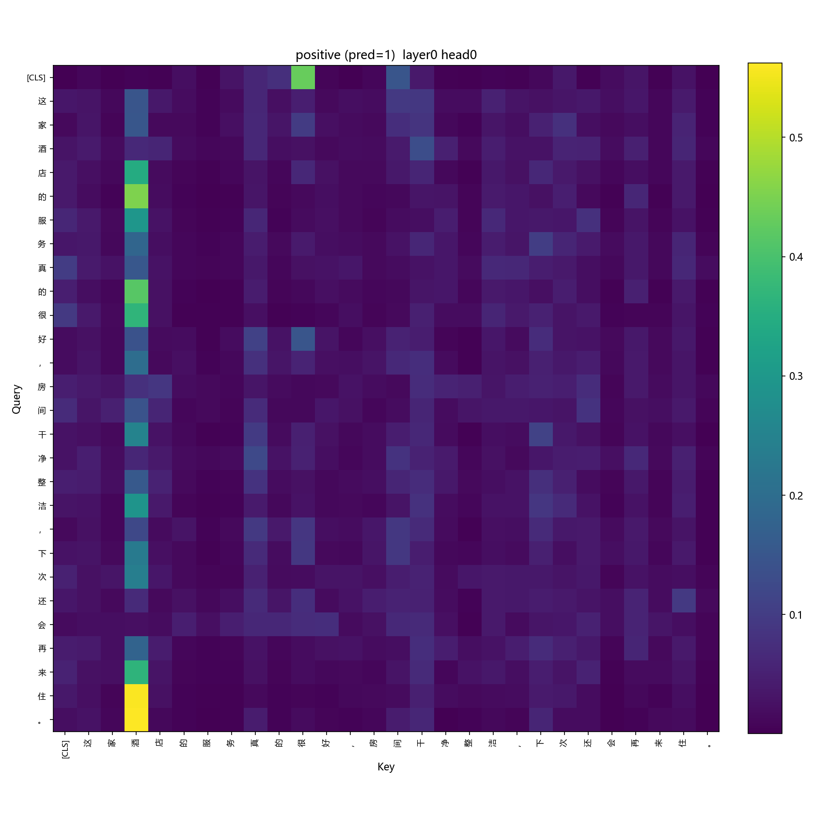
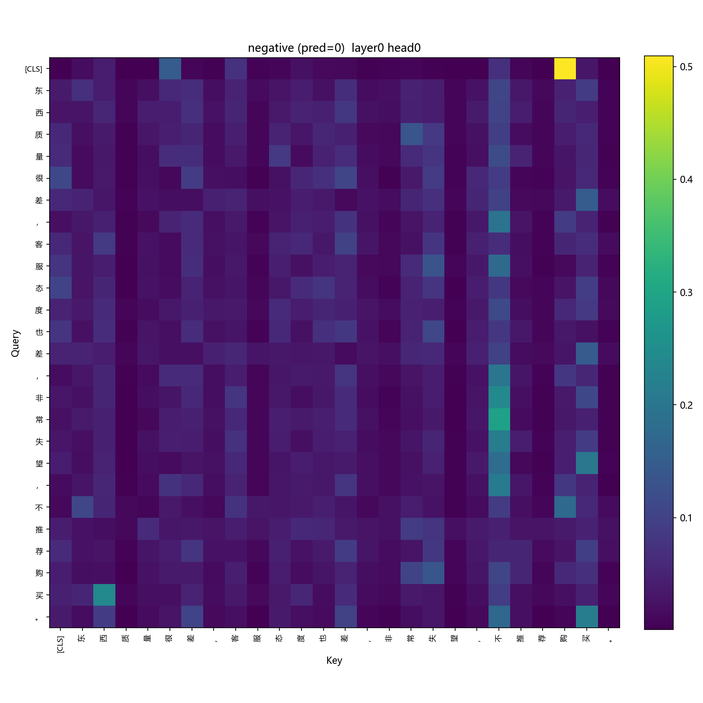
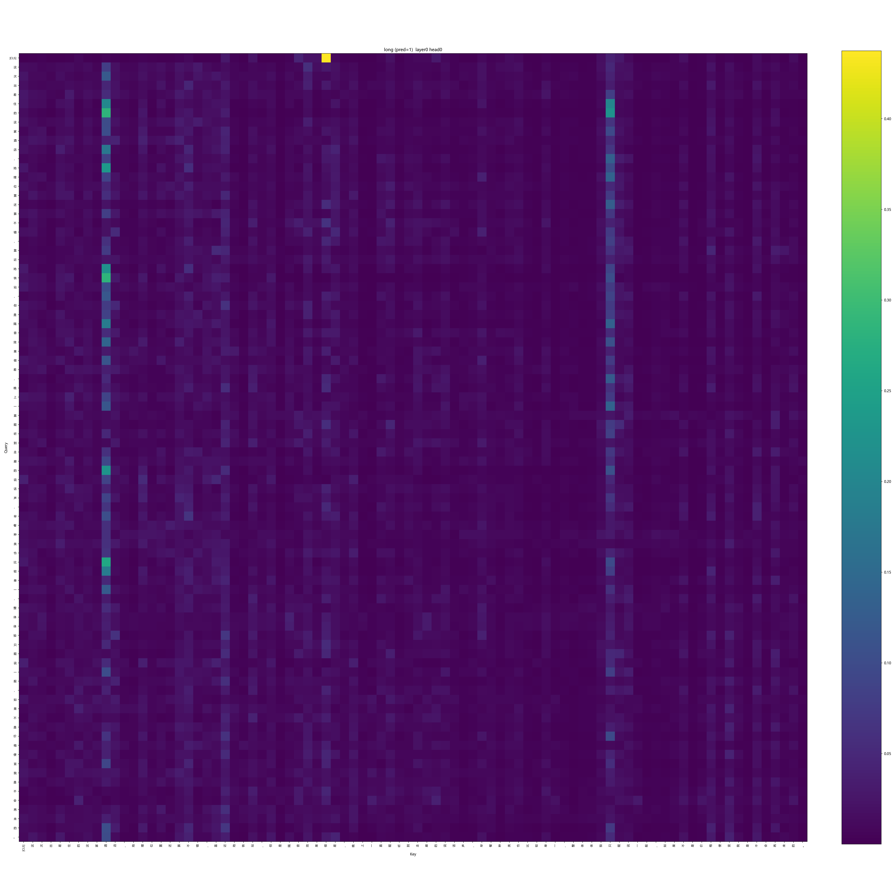

# 注意力可视化结果分析

本文档对 `figures/` 目录下的三张注意力热图进行说明，图片由 [`visualize.py`](../visualize.py) 生成，
展示的是训练好的 `TransformerClassifier`（[`ckpt/best.pt`](../ckpt/best.pt)）在**第 0 层、第 0 个注意力头**上，
对三个测试样本的自注意力权重。

## 模型与训练背景

- 模型配置：`d_model=128, n_heads=4, n_layers=4, d_ff=512, max_len=128`，参数量约 1.34M，字符级词表大小 4253
- 最佳 dev 准确率：**0.8692**（第 7 epoch，≥ 0.80 达标，接近参考基线 0.85）
- 自检结果（[`eval/result.json`](../eval/result.json)）：`attention_correctness`、`causal_mask`、`classifier_accuracy` 三项自检全部通过

## 图片说明

### 1. `attn_positive.png` —— 正面样本

> 原句：「这家酒店的服务真的很好，房间干净整洁，下次还会再来住。」（pred=1，正面）

几乎所有位置的 query 都把注意力集中打到「酒」这个字上（后面接的「店」「服务」「干净」等词共同构成好评语境），
说明这一 head 学到了把整句信息汇聚到句子主题词的能力，而不是均匀关注每个字。

### 2. `attn_negative.png` —— 负面样本

> 原句：「东西质量很差，客服态度也差，非常失望，不推荐购买。」（pred=0，负面）

注意力类似地汇聚到「不」和句尾的「购」（对应「不推荐购买」），恰好是否定和购买意愿的关键触发词，
与情感标签强相关。

### 3. `attn_long.png` —— 长句样本

> 原句：「这次出差住的这家酒店，地理位置还算不错，靠近地铁站，但是隔音效果很差，晚上一直能听到走廊的说话声，
> 早餐种类也比较单一，整体体验只能说一般，如果不是价格便宜我是不会再来的。」

长句里除了继续汇聚到主题词「酒」，还能看到在「隔音效果差」「地铁站」附近出现局部小的注意力峰值，
说明该 head 同时具备一定的局部短语捕捉能力，但整体的「汇聚到主题词」效应仍占主导。

## 综合观察

- 三张图共同的模式是「关键词汇聚」：query 不是均匀分配注意力，而是集中打到句子的主题词或情感关键词上。
- `[CLS]` 位置的注意力本身较分散，说明分类主要依赖后续层对信息的进一步整合，而非仅第一层就完成语义汇聚。
- 训练过程中 loss 单调下降、dev_acc 基本单调上升（仅第 3、8 epoch 略有回落），符合 cosine 学习率衰减 + warmup
  的预期收敛行为，未出现明显震荡，从侧面印证 padding mask、`[CLS]` pooling 和 LayerNorm 位置的实现是正确的。

详见完整实验报告：[`../REPORT.md`](../REPORT.md)。
